

  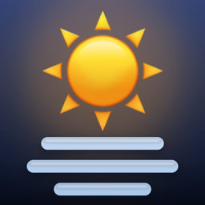

<h1 align="center">Weathervane</h1>

   
  Listed on the App Store as <strong>Dashboard for ECOWITT Weather</strong>

  <strong>Everything your Ecowitt weather station measures, on one clear screen.</strong> 
  For iPhone, iPad, Mac and Apple Watch. Free, with no ads, no account and no tracking.

  
  
  
  

> [!IMPORTANT]
> **This repository is not a download.** It holds Weathervane's documentation and its issue
> tracker. There is no source code and no app file here: the app is closed source and is
> only available from the App Store.
>
> **Get the app: [apps.apple.com/app/id6812456607](https://apps.apple.com/app/id6812456607)**

  <a href="https://leechsoftware.github.io/weathervane/media/weathervane-demo.mp4">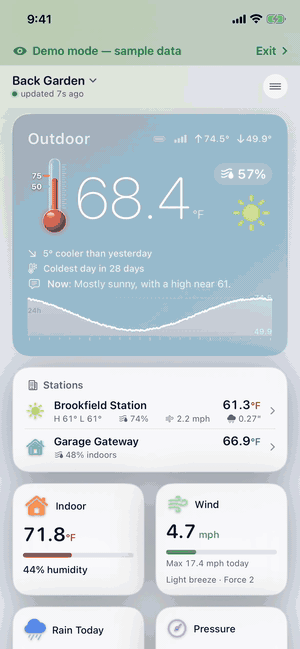</a> 
  <a href="https://leechsoftware.github.io/weathervane/media/weathervane-demo.mp4">Watch the full demo video</a> · recorded in the app's own demo mode, with sample data

## What it is

Weathervane is a dashboard for Ecowitt weather stations. It connects to your gateway or
console over your own Wi-Fi, or to Ecowitt Cloud from anywhere, and shows live conditions at
the top, a tile for every reading, then charts, records, forecast and radar. It keeps your
history, tracks your records, and alerts you when something matters.

You can try all of it without a station: choose **Just show me a sample dashboard** on the
first screen.

## Screenshots

These are the screenshots from the App Store listing.

### iPhone

  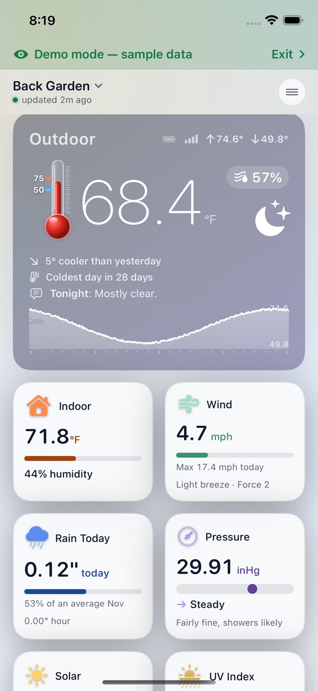
  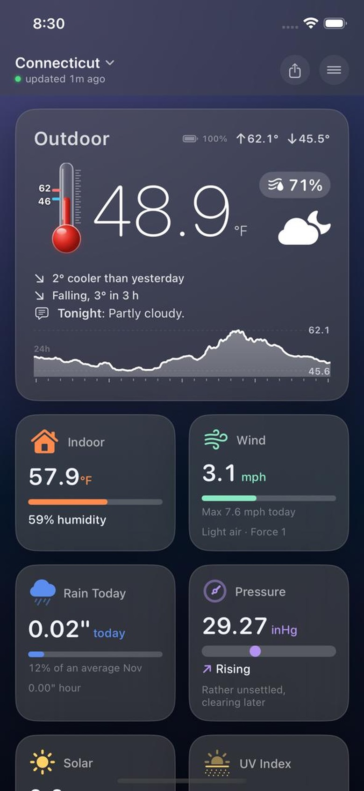
  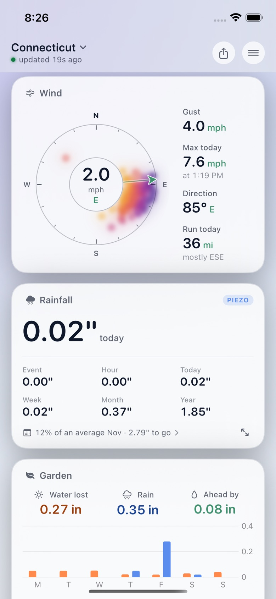

  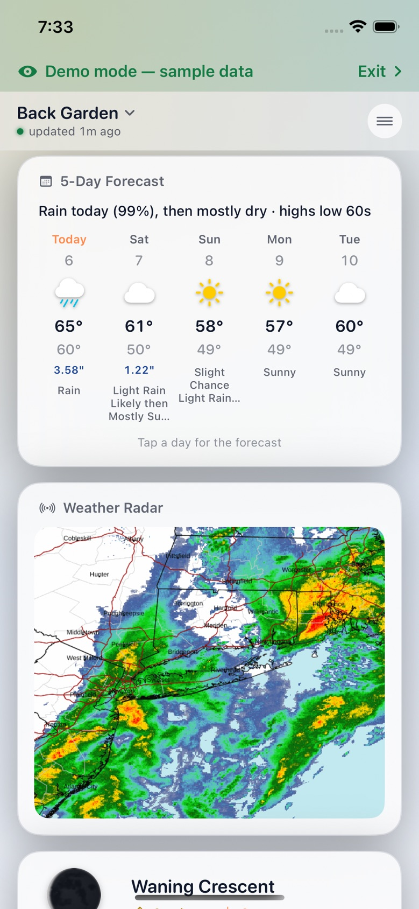
  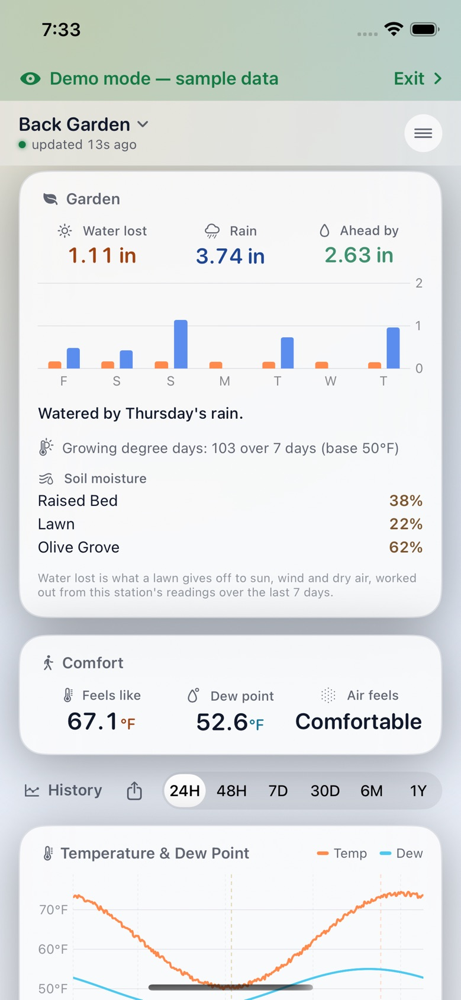
  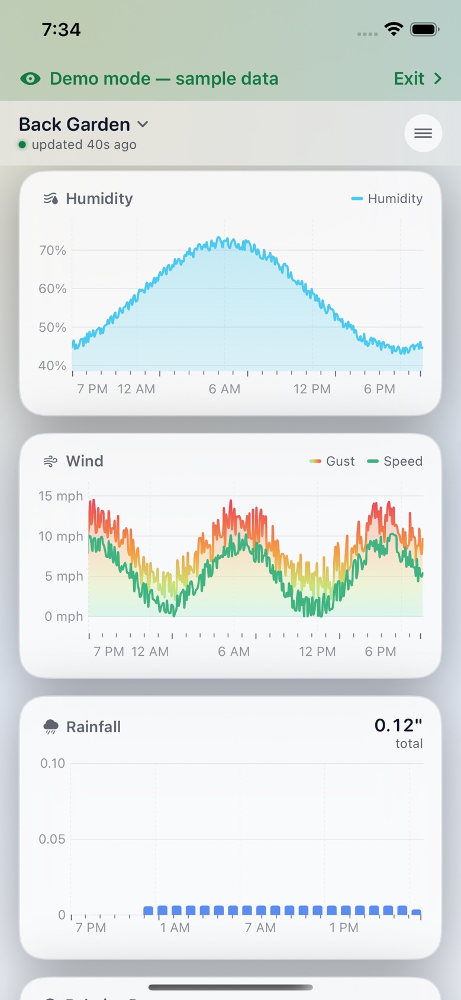

  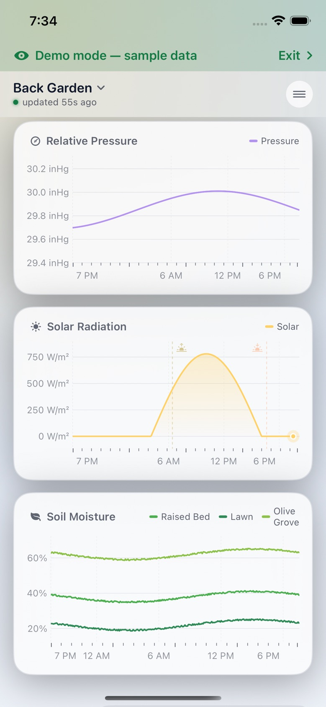
  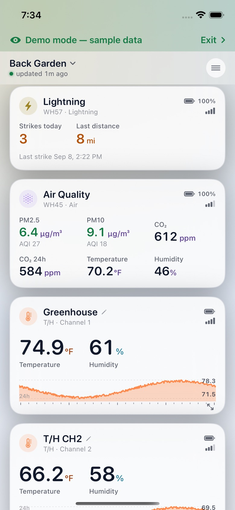
  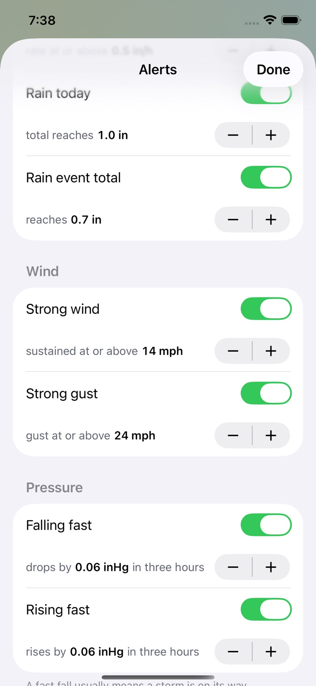

  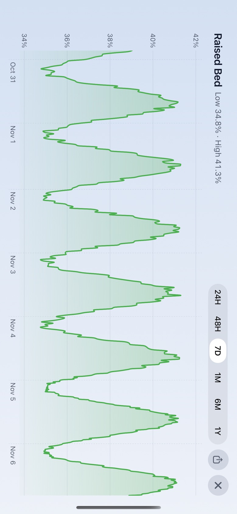

### Mac

  <a href="https://github.com/leechsoftware/weathervane-mac">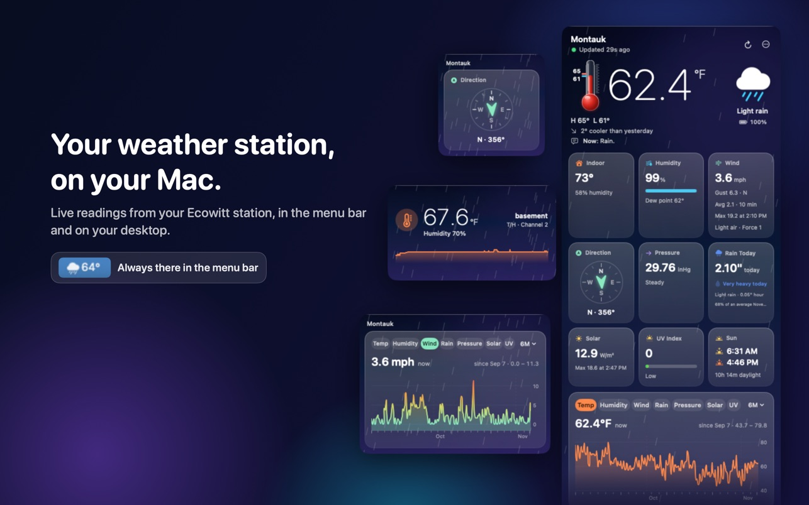</a> 
  The Mac version has its own page: <a href="https://github.com/leechsoftware/weathervane-mac">leechsoftware/weathervane-mac</a>

### iPad

  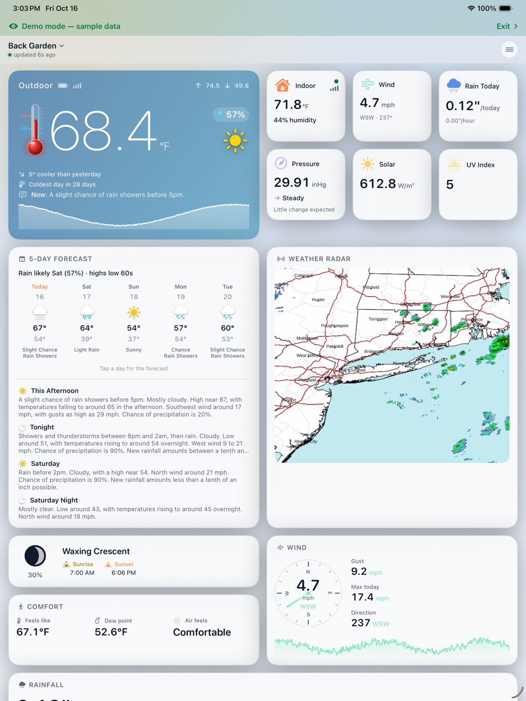
  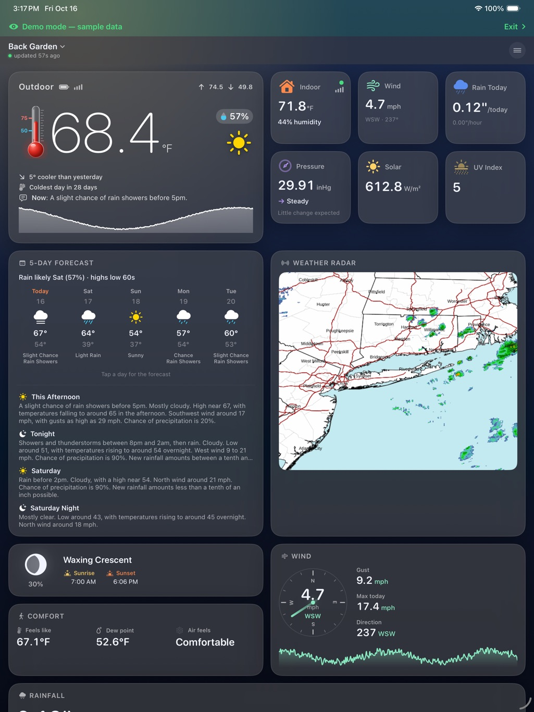
  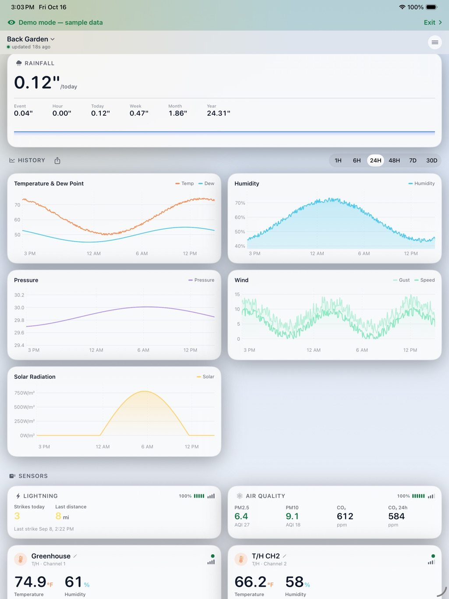

### Apple Watch

  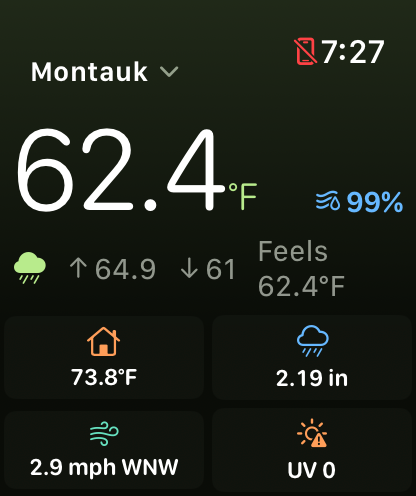

## What it shows

- Outdoor temperature with today's high and low, feels like, humidity and dew point
- Indoor temperature and humidity
- Pressure with its 3-hour trend and a barometer outlook
- Wind speed, gusts and direction on a compass that also shows where the last day's wind came from
- Rain rate and totals for the hour, day, event, week, month and year
- Solar radiation and UV index
- Sunrise, sunset, daylight, moon phase, moonrise and moonset
- Lightning count and distance
- Air quality: PM2.5, PM10, CO2 and AQI
- Soil moisture and temperature, leaf wetness, water level, water leaks
- Battery and signal for every sensor
- Daily, monthly and all-time records
- A 5-day forecast adjusted to your own station, radar and weather warnings

## Documentation

| Page | What it covers |
|---|---|
| [Getting started](docs/getting-started.md) | Installing the app, the first screen, and demo mode |
| [Connecting your station](docs/connecting.md) | Ecowitt Cloud or your own Wi-Fi, and which to choose |
| [Supported hardware](docs/supported-hardware.md) | Gateways, consoles and sensors |
| [Features](docs/features.md) | The dashboard, history, records, forecast and radar |
| [Alerts](docs/alerts.md) | What can alert you, and when alerts are checked |
| [Mac version](https://github.com/leechsoftware/weathervane-mac) | The Mac app has its own documentation |
| [Apple Watch, widgets and Siri](docs/watch-widgets-siri.md) | Your station away from the app |
| [Coverage by region](docs/regions.md) | What works in the US, Europe and elsewhere, and languages |
| [Privacy and data sources](docs/privacy.md) | Where your readings go, and who supplies the forecast and radar |
| [Questions and answers](docs/faq.md) | Common questions and fixes |
| [What's new](docs/whats-new.md) | Recent versions |

## Support

- **A bug or a feature request:** [open an issue](https://github.com/leechsoftware/weathervane/issues/new/choose) here, or use **Contact us** in the app's About screen, which attaches a short report about your devices.
- **Support pages:** [iPhone, iPad and Apple Watch](https://leechsoftware.com/dashboard-for-ecowitt/) · [Mac](https://leechsoftware.com/dashboard-for-ecowitt-mac/)
- **Privacy policy:** [leechsoftware.com/weathervane-for-ecowitt/privacy.html](https://leechsoftware.com/weathervane-for-ecowitt/privacy.html)

Please do not post your Ecowitt application key, API key or account password in an issue.

## About this repository

Weathervane is made by [Leech Software, Inc.](https://leechsoftware.com) The app is closed
source. The text and images in this repository are © Leech Software, Inc. and are here to
document the app; they are not released under an open licence.

Weathervane is independently developed and is not affiliated with or endorsed by Ecowitt.
Ecowitt and its product names are trademarks of their owners.
