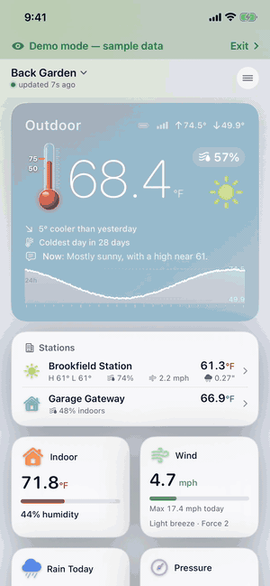

# Weathervane

Everything your Ecowitt weather station measures, on one clear screen. For iPhone, iPad and
Apple Watch, with a [Mac version](https://github.com/leechsoftware/weathervane-mac) too.
Free, with no ads, no account and no tracking.

**[Download on the App Store](https://apps.apple.com/app/id6812456607)**, where it is listed
as Dashboard for ECOWITT Weather.

This site is the app's documentation. It is not a download, and it has no source code: the
app is closed source and is only available from the App Store.

   
  <a href="media/weathervane-demo.mp4">Watch the full demo video</a>, recorded in the app's own demo mode with sample data

## Documentation

- [Getting started](getting-started.md): installing the app, the first screen, and demo mode
- [Connecting your station](connecting.md): Ecowitt Cloud or your own Wi-Fi
- [Supported hardware](supported-hardware.md): gateways, consoles and sensors
- [Features](features.md): the dashboard, history, records, forecast and radar
- [Alerts](alerts.md): what can alert you, and when alerts are checked
- [Apple Watch, widgets and Siri](watch-widgets-siri.md)
- [Coverage by region](regions.md): what works where, and languages
- [Privacy and data sources](privacy.md)
- [Questions and answers](faq.md)
- [What's new](whats-new.md)

## Support

Report a bug or ask for a feature on
[GitHub](https://github.com/leechsoftware/weathervane/issues/new/choose), or use **Contact
us** in the app's About screen.

Weathervane is made by [Leech Software, Inc.](https://leechsoftware.com) It is independently
developed and is not affiliated with or endorsed by Ecowitt.
